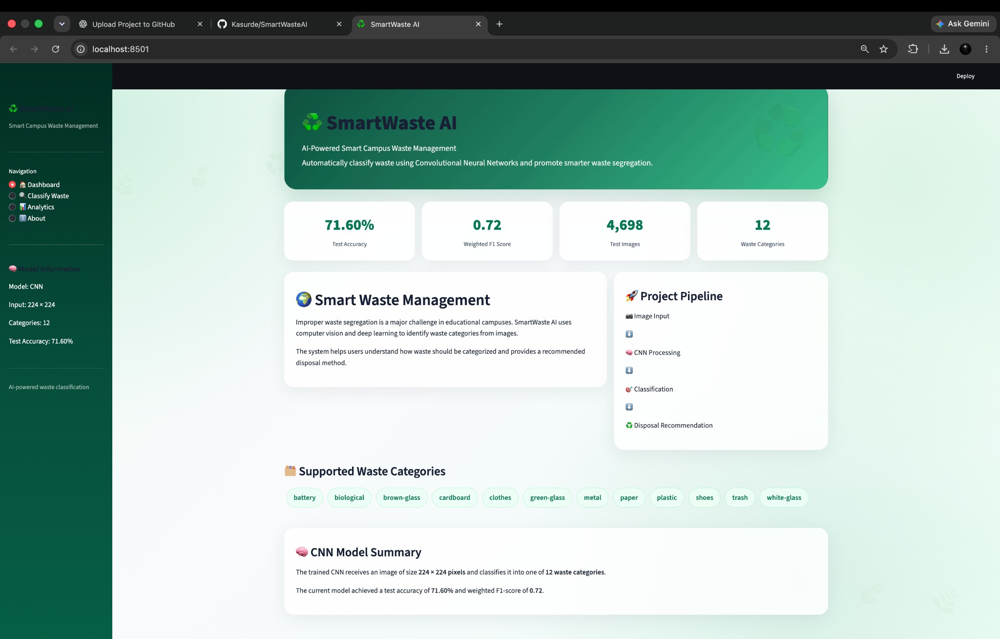
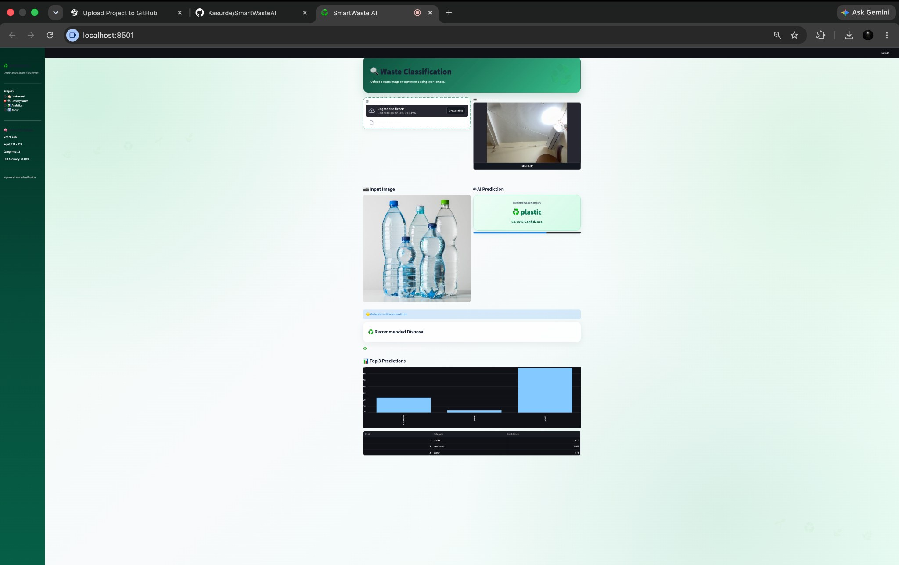
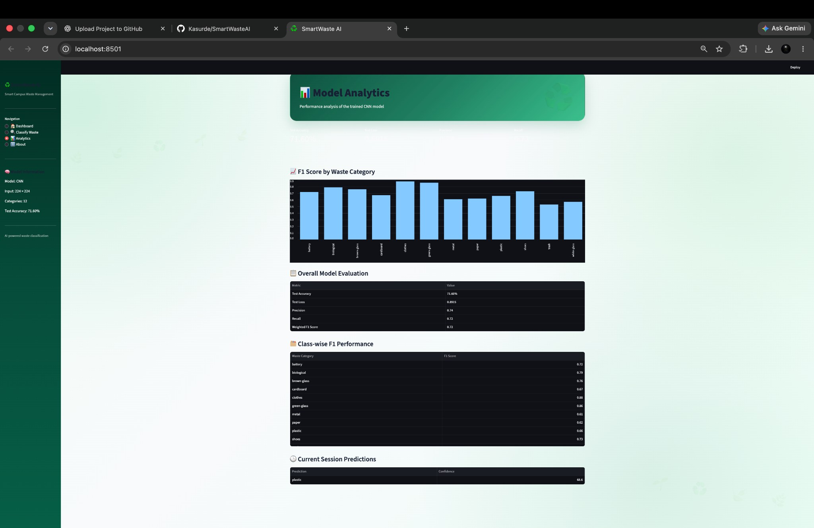
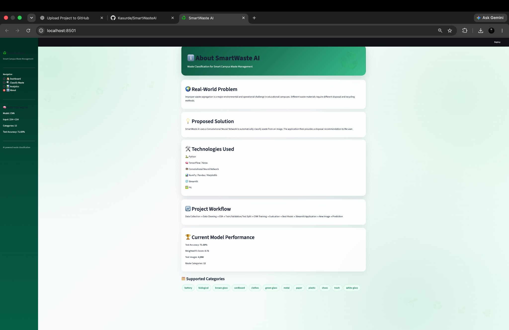

# ♻️ SmartWaste AI — CNN Waste Classification

SmartWaste AI is a Streamlit application that uses a trained Convolutional Neural Network (CNN) to classify waste images into 12 categories and display a disposal suggestion. It is designed as a smart-campus waste-segregation demonstration.

## Features

- Upload a JPG, JPEG, or PNG waste image, or capture one using a camera.
- Classify the image using the trained Keras CNN model.
- Display the predicted category, confidence, and top-three predictions.
- Show a category-specific disposal recommendation.
- Explore model metrics and class-wise F1 scores in the Analytics page.
- Browse project purpose, technologies, workflow, and model information in the About page.

## Supported categories

Battery, biological, brown glass, cardboard, clothes, green glass, metal, paper, plastic, shoes, trash, and white glass.

## Screenshots

These are screenshots supplied from the running local Streamlit application.

### Dashboard



### Waste classification



### Model analytics



### About page



## Project structure

```text
SmartWasteAI/
├── app.py
├── cnn_model.keras
├── class_names.json
├── Waste_Classification_Project.ipynb
├── requirements.txt
├── .streamlit/
│   └── config.toml
├── screenshots/
│   ├── dashboard.jpg
│   ├── classification.jpg
│   ├── analytics.jpg
│   └── about.jpg
├── run_app_mac.sh
└── README.md
```

## Requirements

- Python 3.10–3.12 recommended for broad TensorFlow compatibility.
- macOS, Windows, or Linux.
- The included `cnn_model.keras` file must remain in the same directory as `app.py`.

## Run locally on macOS

1. Extract this project ZIP.
2. Open Terminal in the extracted `SmartWasteAI` folder.
3. Run the helper script:

```bash
chmod +x run_app_mac.sh
./run_app_mac.sh
```

Or install and launch manually:

```bash
python3 -m venv .venv
source .venv/bin/activate
python -m pip install --upgrade pip
pip install -r requirements.txt
streamlit run app.py
```

Open the local URL printed by Streamlit, usually `http://localhost:8501`. To restore normal browser sizing if the page appears unusually small, press **Command + 0** in Chrome to reset browser zoom to 100%.

## Model and reported evaluation

The dashboard currently displays the project's recorded evaluation values: test accuracy 71.60%, test loss 0.8915, precision 0.74, recall 0.72, weighted F1 score 0.72, and 4,698 test images. These are values embedded in the application for display; rerun the evaluation notebook if you need to independently reproduce them.

The CNN expects RGB images resized to 224 × 224 pixels and normalized to the 0–1 range, as implemented in the application.

## GitHub note for the model file

`cnn_model.keras` is larger than GitHub's 100 MB regular-file limit. Use Git Large File Storage (Git LFS) to track it before committing: 

```bash
git lfs install
git lfs track "*.keras"
git add .gitattributes cnn_model.keras
```

If the model is already committed as a normal Git object, migrate the history before pushing: `git lfs migrate import --include="cnn_model.keras" --everything`.

## Technologies

Python · TensorFlow/Keras · CNN · Streamlit · NumPy · Pandas · Matplotlib · Pillow

## Disclaimer

Predictions are model estimates and should be treated as guidance, not as a substitute for local waste-management rules.
